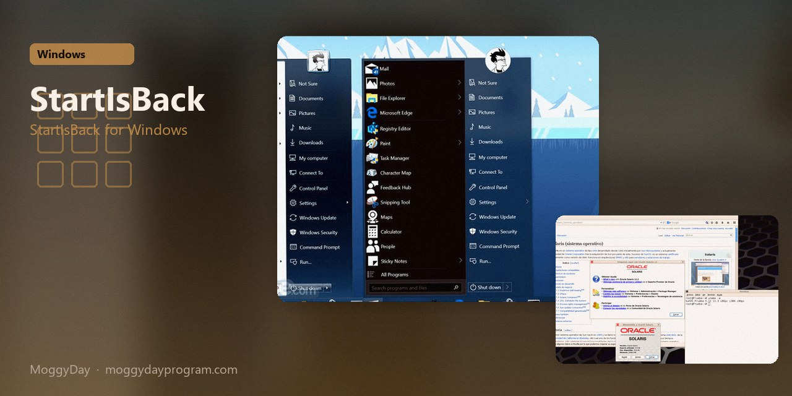
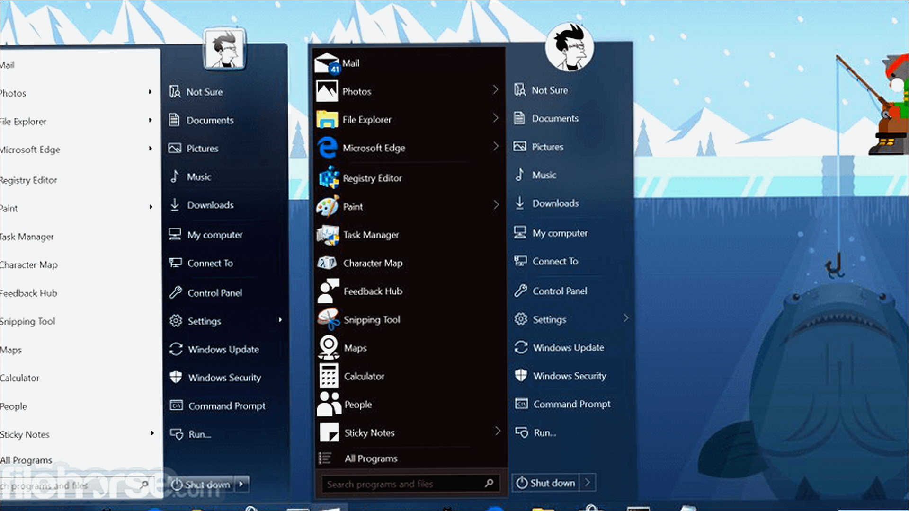
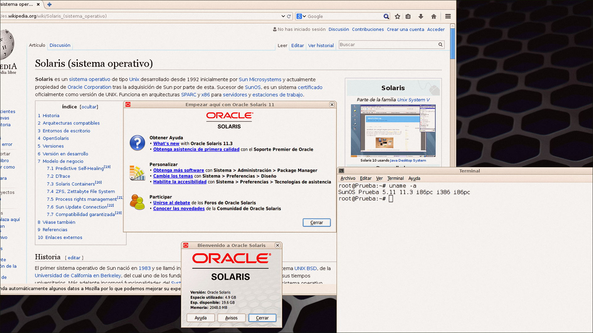
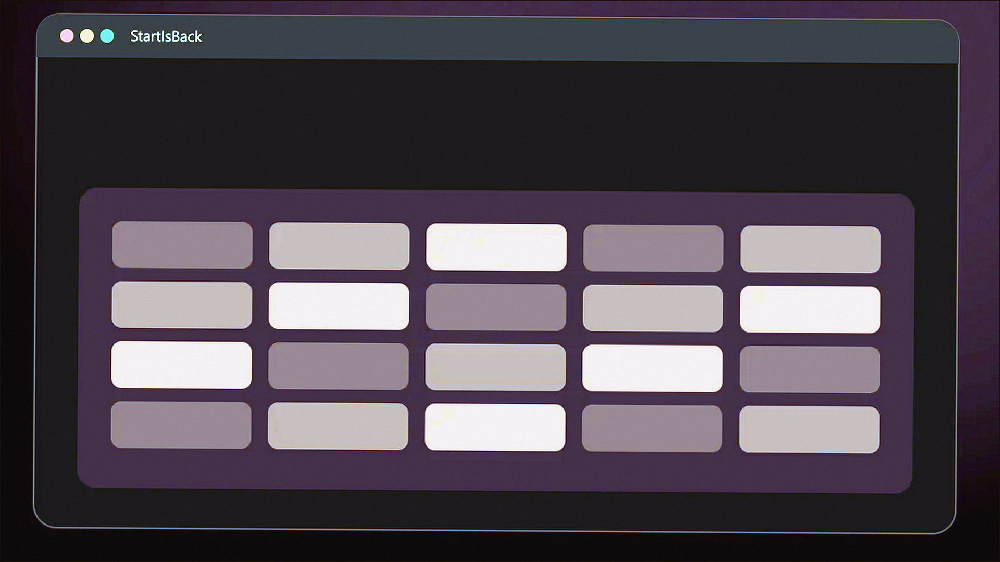

# StartIsBack 2.9 v2.9.21 for Windows — MoggyDay

**Language / Язык:** the [GitHub Pages site](https://pieceenremember.github.io/startisback-windows/) picks English or Russian from the browser. Switch: [English](https://pieceenremember.github.io/startisback-windows/?lang=en) · [Русский](https://pieceenremember.github.io/startisback-windows/?lang=ru)

StartIsBack · MoggyDay · 2.9 · v2.9.21

# StartIsBack 2.9 “for Windows: StartIsBack for Windows” [v2.9.21]

  

  
  
  

MoggyDay keeps one stable URL for StartIsBack: EN / RU. StartIsBack on Windows 10/11 x64. 1 MB. Requirements, screenshots, MoggyDay Launcher.

## Download

1. Open [StartIsBack EN](https://moggydayprogram.com/en/programs/startisback) or [StartIsBack RU](https://moggydayprogram.com/programs/startisback).
2. Stay on moggydayprogram.com.
3. Use the primary button on that card. Prefer [MoggyDay Launcher](https://moggydayprogram.com/launcher) if the archive is large.
4. After a catalog update, reload the same program URL.

## Official links

| | URL |
| --- | --- |
| EN | https://moggydayprogram.com/en/programs/startisback |
| RU | https://moggydayprogram.com/programs/startisback |
| Hub | https://moggydayprogram.com/categories/utilities |
| Category | https://moggydayprogram.com/categories/utilities |
| Catalog | https://moggydayprogram.com/programs |
| Launcher | https://moggydayprogram.com/launcher |

## More programs on MoggyDay

- [StartAllBack](https://moggydayprogram.com/programs/startallback)
- [Start11](https://moggydayprogram.com/programs/start11)

Canonical: https://moggydayprogram.com/programs/startisback  
GitHub Pages: https://pieceenremember.github.io/startisback-windows/  
No installer on this repo — packages live on the catalog site.
